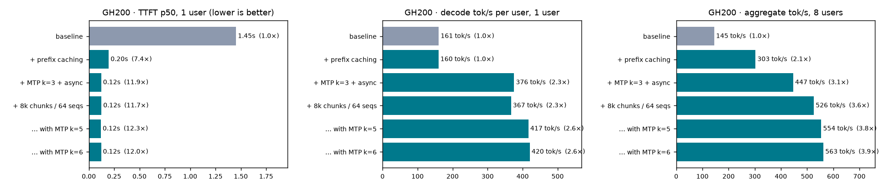
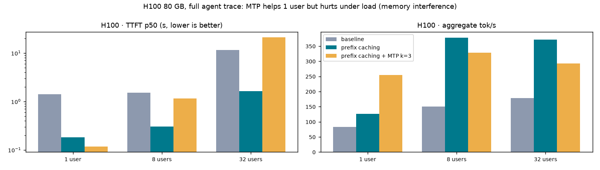

# Lossless inference optimization: Nemotron 3.5 Super VL (NVFP4) on a single Hopper GPU

## tl;dr

- **Model:** `nvidia/NVIDIA-Nemotron-3.5-Super-VL-120B-A12B-NVFP4`, a 120B-parameter MoE (12B active per token) with a hybrid Mamba-Transformer design, served with vLLM 0.33 on **one** GPU. No quantization beyond the published checkpoint.
- **Best agent-traffic results, measured against the same GPU's baseline:**
  - **GH200:** time-to-first-token (TTFT) **12× faster** for one user (1.45 s → 0.12 s) and **10× faster** for 8 users. Throughput **5.1×** at 8 users (149 → 766 tok/s, full trace, MTP k=6). Decode **2.6×** per user (160 → 411 tok/s). For heavy load (32 users), k=3 keeps TTFT at 2.3 s vs 8.8 s with k=6.
  - **H100:** TTFT **12× faster** for one user, with **2.3×** faster decoding.
- **Code generation (LiveCodeBench):** decode speed **2.1–2.2×** for one user and **1.7–1.9×** aggregate throughput, from the model's own multi-token-prediction (MTP) draft heads.
- **What worked:** prefix caching, MTP speculative decoding, and memory configuration. Text-only mode freed 6× more KV cache on the H100 and on its own made 8-user TTFT 3.5× faster. Four kernel and compiler alternatives did *not* beat vLLM's defaults.
- **Key finding:** prefix caching and MTP **reinforce each other when memory allows** (GH200, 96 GB) and **interfere when it doesn't** (H100, 80 GB, under load). So the H100 gets two configs: interactive (one user) and multi-user.
- **Against Together** (same NVFP4 checkpoint, via OpenRouter): **~4× faster TTFT**, and ~78% of their code-generation throughput on one GPU. Their per-user decode is still faster, most likely due to Blackwell hardware and fleet scale.
- **Lossless:** same weights and numerical formats throughout. At a 32k reasoning budget, the baseline and the optimized config both score **58.3%** on LiveCodeBench, with the same pass/fail on 56/60 problems (the other 4 split 2–2). Together scores 61.7%.
- **Cost:** ~$25–30 of the $200 budget (Lambda GPU-hours plus OpenRouter tokens).

## Setup & constraints

| | |
|---|---|
| Model | Nemotron 3.5 Super VL 120B-A12B, **NVFP4 checkpoint** (4-bit routed experts, FP8 projections, FP8 KV cache with calibrated scales). Chosen over DeepSeek V4.1 Flash, which needs ~511 GB (8 GPUs) and has no MTP heads |
| Engine | vLLM 0.33.0 (torch 2.14 / CUDA 13, FlashInfer 0.7.2) |
| GPUs (Lambda) | **1× H100 SXM 80 GB** (primary), **1× GH200 96 GB** (aarch64), **1× H100 PCIe 80 GB** (accuracy runs only). No B200/H200 or multi-GPU capacity appeared during the window, so these were grabbed one at a time as they showed up |
| Provider reference | **Together, via OpenRouter**, provider pinned with no fallbacks. Fireworks offered this model only as a dedicated 4× B200 deployment |
| Budget | $200 total for GPUs and provider API; ~$25–30 spent |
| Time | 4 hours |

The plan assumed one 8×B200 node split into 8 parallel experiment lanes. With single GPUs instead, the lanes ran one after another on each box, and **each box has its own baseline**. Every deviation and setup fix is logged in [`NOTES.md`](NOTES.md).

## Methodology

**Workloads.** Every endpoint got byte-identical prompts from the same client (`bench/bench.py`).

1. **Agent trace (synthetic, built to look like coding-agent traffic):**
   - A 15.5k-token prefix shared by every session: agent instructions, 15 tool schemas, and repository source files.
   - About 6k tokens of per-session files.
   - Multi-turn "edit this function, reply with a diff" requests, with canned assistant turns so prompts stay identical across endpoints.
   - Prompts are 21–22k tokens; outputs are capped at 256 tokens with thinking on.
   - Short variant: 8 sessions × 3 turns (used for sweeps). Full variant: 32 sessions × 5 turns (used for final runs).
   - It is **not** an official dataset (see Limitations).
2. **LiveCodeBench (code generation):** the 60 most recent problems of the public v6 set, March 8 to April 6, 2025 (30 hard, 18 medium, 12 easy). Short prompts, long reasoning outputs, and graded by unit tests. It's the decode-heavy workload and the accuracy check. Speed sweeps used 8 of the problems; accuracy runs used all 60.

**Metrics:**
- TTFT p50/p99, overall and split into first turns vs later turns.
- Per-user decode tok/s and aggregate output tok/s.
- Measured at concurrency 1, 8, and 32 (full trace).
- Prompts carry a random per-run tag, so no run can reuse another run's cache, including on endpoints we can't flush.

**Design:**
- Baseline: stock vLLM with prefix caching off and no speculation.
- Each optimization is added on its own, then combined.
- Each GPU is compared only to its own baseline.
- **Noise floor:** repeating the baseline on the same box agreed within **≤1.5%** (H100) and **≤0.3%** (GH200).

**Provider comparison:**
- Together via OpenRouter, run from the H100 node with the same traces.
- Network round-trip is ~3 ms TCP connect (~65 ms with TLS on a fresh connection), so it accounts for little of their TTFT.
- Their hardware is unknown (most likely Blackwell) and shared with other customers.
- Their full-trace concurrency-8 run hit OpenRouter rate limits, so their aggregate numbers aren't comparable; we compare TTFT and per-user decode only.

## Losslessness

**Definition used:** no change to weights or numerical formats beyond the published HF checkpoint. NVFP4 experts, FP8 projections, the checkpoint's FP8 KV cache with its calibrated scales, and default Mamba state precision are all unchanged.

**Excluded because they would lose precision:**
- `--mamba-ssm-cache-dtype float16` with stochastic rounding (suggested on the model card).
- MARLIN with FP8 or INT8 activations.
- HUMMING with FP16 accumulation.
- Any further KV or weight quantization.

**Why bit-exact output comparison doesn't work for this model:** temperature-0 outputs from the **same baseline config** run at concurrency 8 vs concurrency 1 matched exactly on only **0/40** prompts (H100) and **1/40** (GH200). They diverged after ~8–17% of the output. Batch shape changes which kernel variant runs and the order of floating-point sums, and long reasoning traces have many near-ties between tokens. The optimized config diverges from the baseline **no more** than the baseline diverges from itself (H100: 1/40 exact, median divergence 12% in).

**Evidence instead:**
1. **By construction:**
   - Prefix caching reuses the KV values computed for the identical prefix.
   - MTP uses rejection sampling, which provably preserves the target model's output distribution. At temperature 0 it emits exactly the target model's argmax.
   - Text-only mode skips an encoder the text path never uses.
   - Everything else is scheduling or kernel selection.
2. **Equal task accuracy at equal budgets:**

| LiveCodeBench (60 problems, 1 sample, temperature 1.0) | pass@1 | Correct among completed answers | No code (hit the token cap) |
|---|---|---|---|
| Together, 8k budget | 46.7% | 97% (28/29) | 31 |
| Ours, H100 **baseline** config, 8k budget | 48.3% | 97% (29/30) | 30 |
| Ours, H100 final config, 8k budget | 41.7% | 96% (25/26) | 34 |
| Ours, GH200 final config, 8k budget (sample 1) | 43.3% | 93% (26/28) | 32 |
| Ours, GH200 final config, 8k budget (sample 2) | 48.3% | 97% (29/30) | 30 |
| Together, 32k budget | 61.7% | 95% (37/39) | 21 |
| Ours, final config, 32k budget (H100 PCIe) | 58.3% | 95% (35/37) | 23 |
| Ours, **baseline** config, 32k budget (H100 PCIe) | **58.3%** | 95% (35/37) | 23 |

**At the 32k budget, baseline and final config score identically: 58.3%, with the same easy/medium/hard split (12/12, 14/18, 9/30).** Per problem, they reach the same pass/fail result on **56/60** problems, and the other 4 split 2–2. For comparison, each agrees with Together on only 52–54/60 problems.

With one sample per problem, pass@1 over 60 problems has a standard error of about ±6 points. Every difference above is within that, and it's explained by how many answers hit the token cap. The absolute scores sit below the model card's 87.4 because this subset is hard-heavy and the reasoning budget is capped (see Limitations).

## Results

### H100 SXM 80 GB, full agent trace (32 sessions × 5 turns)

| Concurrency | Metric | Baseline | Prefix caching | Prefix caching + MTP k=3 |
|---|---|---|---|---|
| 1 | TTFT p50 | 1.41 s | 0.18 s (7.7×) | **0.12 s (12.1×)** |
| 1 | Per-user decode | 153 tok/s | 153 tok/s | **351 tok/s (2.3×)** |
| 1 | Aggregate | 83 tok/s | 127 tok/s | **255 tok/s (3.1×)** |
| 8 | TTFT p50 | 1.51 s | **0.30 s (5.0×)** | 1.14 s |
| 8 | Aggregate | 150 tok/s | **378 tok/s (2.5×)** | 329 tok/s |
| 32 | TTFT p50 | 11.5 s | **1.6 s (7.1×)** | 21.1 s |
| 32 | Aggregate | 178 tok/s | **371 tok/s (2.1×)** | 292 tok/s |

All H100 numbers use `--language-model-only` and 97% GPU memory utilization (see "memory fix"). Before that fix, the c=8 baseline TTFT was 7.3 s.

### GH200 96 GB, full agent trace

| Concurrency | Metric | Baseline | **Combined best** (prefix caching + MTP k=3 + async + 8k chunks/64 seqs) | Same with **MTP k=6** |
|---|---|---|---|---|
| 1 | TTFT p50 | 1.45 s | **0.12 s (12×)** | **0.12 s (12×)** |
| 1 | Per-user decode | 160 tok/s | 370 tok/s (2.3×) | **411 tok/s (2.6×)** |
| 8 | TTFT p50 | 1.99 s | **0.20 s (10×)** | 0.21 s (9.7×) |
| 8 | Per-user decode | 22 tok/s | 127 tok/s (5.8×) | **142 tok/s (6.4×)** |
| 8 | Aggregate | 149 tok/s | 685 tok/s (4.6×) | **766 tok/s (5.1×)** |
| 32 | TTFT p50 / p99 | 11.8 s / 42.6 s | **2.3 s / 16.1 s** | 8.8 s / 18.5 s |
| 32 | Aggregate | 174 tok/s | **435 tok/s (2.5×)** | 426 tok/s (2.4×) |

**Choosing the MTP depth on the GH200:** k=6 is better up to ~8 concurrent users (+12% aggregate and per-user decode vs k=3, same TTFT). At 32 users the GPU is saturated: verifying 7 tokens per sequence queues requests, and TTFT rises from 2.3 s to 8.8 s. Use **k=6 for interactive or light multi-user traffic** and **k=3 for heavy load**.

### GH200 ablation, short agent trace, c=8 (each step added to the previous one)

| Config | TTFT p50 | Per-user decode | Aggregate |
|---|---|---|---|
| Baseline | 2.11 s | 22 tok/s | 145 tok/s (1.0×) |
| + prefix caching | 0.35 s | 61 tok/s | 303 tok/s (2.1×) |
| + MTP k=3 (+ async) | **0.21 s** | 130 tok/s | 447 tok/s (3.1×) |
| + 8k prefill chunks / 64 sequences | 0.25 s | 139 tok/s | 526 tok/s (3.6×) |
| … with MTP **k=5** instead of 3 | **0.21 s** | **157 tok/s** | **554 tok/s (3.8×)** |
| … with MTP k=6 | 0.22 s | **159 tok/s** | **563 tok/s (3.9×)** (+1.5% vs k=5, ≈ noise floor: the curve plateaus at k=5–6) |
| … with MTP k=7 | 0.22 s | 153 tok/s | 572 tok/s (3.9×) (single-user decode 414 vs 420 at k=6; plateau confirmed) |
| … with 16k chunks instead of 8k (k=3) | 0.24 s | 137 tok/s | 525 tok/s (no gain over 8k) |

### Code generation: LiveCodeBench (short prompts, long outputs)

| | H100 baseline | H100 MTP k=3 | GH200 baseline | GH200 MTP k=3 | Together |
|---|---|---|---|---|---|
| c=1 per-user decode | 153 tok/s | **331 tok/s (2.2×)** | 162 tok/s | **340 tok/s (2.1×)** | 557 tok/s |
| c=8 aggregate | 591 tok/s | **1,033 tok/s (1.75×)** | 608 tok/s | **1,022 tok/s (1.7×)** | 1,324 tok/s |
| c=1 TTFT | 0.11 s | 0.12 s | 0.12 s | 0.13 s | 0.54 s |

On the **full** LiveCodeBench trace (24 problems at c=8), the GH200 combined config reaches **981 tok/s with k=3** and **1,056 tok/s with k=6 (1.97× the 535 tok/s baseline)**. Single-user code decode is about the same at k=3 and k=6 (341 vs 345 tok/s).

### Against Together (same NVFP4 checkpoint), short agent trace

| | Together | Ours, H100 (prefix caching + MTP) | Ours, GH200 (combined) |
|---|---|---|---|
| c=1 TTFT p50 | 0.53 s | **0.12 s** | **0.12 s** |
| c=8 TTFT p50 | 0.62 s | 0.34 s (prefix caching only) | **0.21 s** |
| c=1 per-user decode | **600 tok/s** | 366 tok/s | 376 tok/s |

## Optimizations that worked

| Optimization | Mechanism | Best measured gain | Notes |
|---|---|---|---|
| **Prefix caching** (`--enable-prefix-caching --enable-mamba-shared-prefix-checkpoint --block-size 64 --prefix-match-unit 64`) | Agent turns re-send a long, mostly unchanged prompt. Prefill is skipped for the cached part, and Mamba state is checkpointed at block boundaries | TTFT **7–12×**, aggregate **2–2.5×** under load | Costs ~3% plus slightly higher TTFT on one-off prompts with no reuse. Hit rate 78% on the agent trace |
| **MTP speculative decoding** (`--speculative-config '{"method":"mtp","num_speculative_tokens":3}'`) | The model's own draft heads propose 3 tokens per step, verified in one forward pass | Single-user decode **2.1–2.6×**. Draft acceptance 79% (k=3) on code | k=2 / 3 / 5: 85% / 79% / 65% acceptance. *Alone*, k=5 gives the fastest single-user decode but worse TTFT under load. *With prefix caching*, k=5 beats k=3 at every concurrency on agent traffic (GH200: 417 tok/s per user, 554 aggregate at 8 users), because prefix caching frees the compute deeper drafts need. On code generation, k=5 ≈ k=3 |
| **Memory fix** (`--language-model-only`, `--gpu-memory-utilization 0.97`) | Skipping the unused vision encoder freed its weights and activation reserve: H100 KV cache went from **1.04 to 6.28 GiB** | 8-user TTFT on the H100 **3.5×** faster (7.3 s → 2.1 s), before anything else | It's also what made MTP fit on the H100 at all |
| **Prefix caching + MTP together** (when memory allows) | Prefix caching removes most of the prefill work, and the freed compute is what MTP needs to verify its drafts | GH200 at 8 users: per-user decode **4.5×** what MTP alone achieved | Reinforcing, not just additive. But see the H100 interference below |
| **Big prefill chunks** (`--max-num-batched-tokens 8192 --max-num-seqs 64`, GH200) | Fewer, larger prefill chunks; more sequences resident | +18% aggregate, p99 TTFT −27% at 8 users | Median TTFT +19% (large chunks briefly stall decoding). Needs the GH200's spare memory |

## Optimizations that didn't work

| Tried | Result | Why |
|---|---|---|
| Prefix caching + MTP on the **H100 under load** | At 32 users: TTFT 21 s vs 1.6 s with prefix caching alone; −21% aggregate | MTP's ~1.7 GiB of draft weights plus extra Mamba checkpoints evict cached prefixes. Hits fell from 820k to 599k tokens (78% → 57%) |
| `--moe-backend marlin` (instead of the auto-selected HUMMING) | −15% aggregate at 8 users; first-turn TTFT +25% | Same speed as HUMMING at batch 1, slower on large-batch prefill |
| `VLLM_HUMMING_MOE_GEMM_TYPE=grouped` | −12–16% single-user decode | The grouped GEMM variant is worse at small batch sizes |
| `-O3` compilation | Within noise (±1.5%) | CUDA graphs already cover decode |
| `--performance-mode interactivity` / `throughput` | Within noise, apart from +6% for interactivity at 8 users on the H100 combo | vLLM's defaults are already well suited to these batch shapes |
| **SGLang 0.5.23** (alternative engine, configured to match the vLLM multi-user and interactive configs) | **Could not start on 1× H100 80 GB** after 5 attempts | Its `--language-only` means encoder-disaggregation mode, which this model doesn't support, so it isn't a text-only switch. Without it, SGLang loads the vision encoder. Its DeepGEMM JIT needed nvcc ≥ 12.9 and ninja, absent on Lambda Stack (fixed with pip-installed ninja/nvcc). It then pre-allocates 162 MB of Mamba state per request and ran out of memory at `--mem-fraction-static` 0.90 and 0.96 (16 requests). vLLM serves the same model with 6.3 GiB of KV cache to spare. Logs: `results/h100/logs/*sglang*` |
| `--async-scheduling` | Within noise | CPU scheduling isn't the bottleneck at these batch sizes |
| MTP **k=2** instead of k=3 on the H100 combo, to reduce interference | c=8: 266 tok/s aggregate and 1.94 s TTFT, vs k=3's 215 tok/s / 3.45 s and prefix caching alone's 307 tok/s / 0.34 s. c=1 decode 316 vs 366 tok/s | A shallower draft uses less memory and evicts fewer cached prefixes, but prefix caching alone still wins under load, so we kept two H100 configs |

## Not tried (4-hour limit)

- **B200 / native FP4.** Hopper has to unpack the 4-bit weights to 16-bit for every computation, while Blackwell runs FP4 natively and has 2.4× the memory bandwidth. No B200 capacity appeared on Lambda during the window. This is the most likely reason Together's per-user decode is faster.
- **Custom kernels.** A rough calculation from memory bandwidth (~8 GB of active weights read per token, 3.35 TB/s on the H100) puts the ceiling at ~400 tok/s for single-user decode without speculation. The baseline reaches 153, ~38% of that. The decode profile (appendix) shows **49% of GPU time in the 4-bit MoE GEMMs and 38% in FP8 dense GEMMs**, with attention and Mamba at only ~5%. So the headroom is in small-batch GEMM kernels, and that's weeks of work, not hours.
- **TensorRT-LLM.** NVIDIA's own stack is the most likely to have tuned kernels for this NVIDIA model, especially with native FP4 on Blackwell. But the model card says it needs a specific build with a Mamba-cache patch, which wasn't feasible in the remaining time.
- n-gram / prompt-lookup speculation, CPU KV offload (unnecessary once the KV cache fit), prefill/decode disaggregation (needs ≥2 GPUs), vLLM batch-invariant mode (for bit-exact verification), and replaying real agent trajectories (SWE-agent / OpenHands).

## Limitations & caveats

- **The agent trace is synthetic.** Prefix-caching gains depend on its assumed 15.5k-token prefix shared by every session. That's realistic for one agent product with a long system prompt and tool list, and optimistic for mixed traffic.
- **The LiveCodeBench subset is the newest 60 problems,** hard-heavy, sampled once each, and graded by our own reimplementation of the harness. It's valid for relative comparison, not for reproducing the model card's absolute score. The problems predate the model's release, so contamination can't be ruled out.
- **The provider comparison isn't apples to apples:** different, unknown hardware, shared with other customers, and rate-limited at higher concurrency.
- **Speeds are single runs** (repeat noise ≤1.5%). Accuracy is a single sample per problem (±6 pts).

## How to reproduce

- **Run the best configs:** [`deploy/README.md`](deploy/README.md). `./setup.sh` handles CUDA forward-compat, vLLM 0.33.0, FlashInfer kernels and pinned model weights. Then pick a serve script: `serve_h100_interactive.sh`, `serve_h100_multiuser.sh` or `serve_gh200_best.sh`.
- **Rerun the experiments:** [`bench/README.md`](bench/README.md). It covers the node setup, the sweep runner, the trace files (checksums listed), and the benchmark client that works with any OpenAI-compatible endpoint.
- **Exact environment per box:** [`env/`](env/). GPU, driver, package versions, and model revision `3acb09951cff50cda7be0200ebbad2c15a3e63ba`.
- **Raw results:** [`results/`](results/). Per-request JSONL, per-config summaries, and the LiveCodeBench grades.

## Appendix: technical details

**Decode-step profile** (H100 SXM, prefix-caching config, single-user decode, PyTorch profiler via `--profiler-config`; `results/profile_h100_summary.txt`):

| GPU kernel time | Share | Kernels |
|---|---|---|
| MoE expert GEMMs + routing | **49%** | HUMMING 4-bit-weight / 16-bit-compute GEMMs (4 shapes), top-k routing, block alignment |
| Dense FP8 GEMMs | **38%** | CUTLASS SM90 FP8 (Mamba and attention projections, quantized FP8 in the checkpoint), nvjet split-K |
| Norms / activations / elementwise | 7.5% | fused Triton kernels (e.g. squared-ReLU) |
| Mamba scan + conv update | 3.4% | `_selective_scan_update_kernel`, `_causal_conv1d_update_kernel` |
| Attention | 1.8% | FlashAttention (SM90) |
| Sampling | 0.2% | |

About 87% of decode time is GEMMs at batch 1–4, which are limited by how fast weights can be read from memory. That's where custom kernels or Blackwell's native FP4 would pay off. Attention and the SSM together are ~5%, so optimizing them would barely matter.

**Memory budget (1 GPU, 40k max context):**

| | H100 v1 (with vision encoder) | H100 (text-only, 0.97) | H100 + MTP | GH200 (text-only, 0.95) |
|---|---|---|---|---|
| Weights | 69.6 GiB | 68.0 GiB | ~69.7 GiB | 68.0 GiB |
| KV cache | 1.04 GiB (175k tokens) | 6.28 GiB (1.06M tokens) | ~4.6 GiB | 19.24 GiB (3.26M tokens) |

**Kernels selected on Hopper:** HUMMING NVFP4 linear and MoE kernels (W4A16: 4-bit weights unpacked to 16-bit for compute), FlashAttention, and FlashInfer for the Mamba ops.

**Setup issues hit:** FlashInfer kernels were missing (`vllm download-kernels`); the NVRTC library path; the CUDA forward-compat package on driver 570; an aarch64 gcc `-march` bug in video profiling; and vLLM 0.33 flag renames. Details in [`NOTES.md`](NOTES.md).
